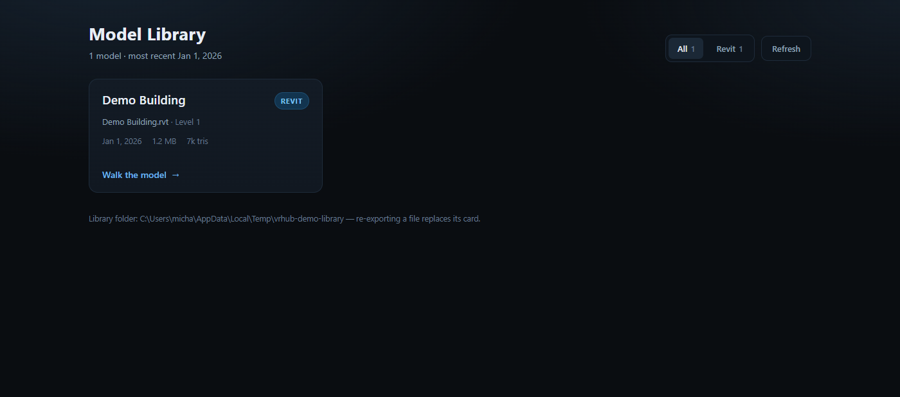

# VirtualHub

Walk your own CAD models in a Quest 3 — from **Revit** or **IngeTrazo** — in the headset's own
browser. No game engine, no licence, no APK to sideload.



VirtualHub is two plugins around one shared runtime:

| Piece | What it is |
|---|---|
| `plugins/revit` | Revit add-in: one ribbon button exports the active 3D view, derives analytic colliders from the model, and opens it on the headset. |
| `plugins/ingetrazo` | IngeTrazo extension: the same walkthrough, with colliders derived from geometry instead of parametric walls. |
| `web/` | The shared web app: a model-library homepage and the WebXR viewer (three.js, no build step). |
| `server/` | A standalone static server for the library — the Revit plugin launches it, and you can run it on its own. |
| `contracts/` | The rules both plugins must agree on: slug cases, library metadata schema. |

Every export publishes into one library on disk, keyed by the document's file name, so exporting
again replaces that model's card instead of adding a duplicate. Either plugin's server serves the
same homepage, so the list is the same whichever door you came through.

## What it does

- **Click, then be inside the model.** The export runs from the CAD app; seconds later the model is
  in the headset.
- **Walls are solid and doorways are passable.** Collision is analytic — a few hundred 2D tests
  behind a spatial hash — not a sweep against hundreds of thousands of triangles.
- **Walk, climb stairs, snap-turn, fly.** Left stick walks, right stick snap-turns, right grip
  toggles fly, either trigger is 3× speed, left grip draws the collision world.
- **One library.** Revit models and IngeTrazo models appear side by side, newest first.
- **No certificate prompt on the one-click path.** `adb reverse` puts the server on the headset's
  own `localhost`, which browsers treat as a secure origin, so WebXR works with no certificate.

## Quick start

Requires Windows, a Quest 3, and the CAD app you want to export from.

**Revit** (2025 or 2026; needs the .NET SDK matching Revit's runtime):

```powershell
.\plugins\revit\build.ps1        # builds, installs the add-in, smoke-tests the server
```

Then in Revit: **Add-Ins ▸ RevitVR ▸ Enter VR**.

**IngeTrazo**:

```powershell
.\plugins\ingetrazo\install.ps1  # copies the plugin and the shared web app
```

Then in IngeTrazo: **Extensions ▸ Export to VR**. Restart IngeTrazo first if it was open.

**The headset.** With the headset connected over USB (Developer Mode on, USB debugging allowed),
either plugin forwards the port and opens the page for you. Without adb, open:

```
https://<this-pc>:8766/      (Revit plugin's server, accept the certificate once)
https://<this-pc>:8771/      (IngeTrazo plugin's server)
```

`http://192.168.x.x` will not work: it is not a secure origin, so WebXR is refused — a browser
rule, not a setting here.

**Just the library, no CAD app:**

```powershell
dotnet run --project server/RevitVr.Server -- --app web --library "$env:LOCALAPPDATA\VRHub\library"
```

or double-click the **Model Library** shortcut that `build.ps1` can install.

## The model library

```
%LOCALAPPDATA%\VRHub\library\
  196-sw-2025\              one folder per document file name
    meta.json               name, source, view, export time, triangle count
    scene\                  scene.glb, colliders.json (+ railings/textures from Revit)
  farnsworth-house\
```

The folder is a slug of the document name, so re-exporting replaces the entry. Details, routes and
the metadata schema: [docs/library-format.md](docs/library-format.md).

## Documentation

| | |
|---|---|
| [docs/architecture.md](docs/architecture.md) | components, data flow, ports, why two servers, what the tests cover |
| [docs/library-format.md](docs/library-format.md) | library folder, `meta.json`, slug rules, HTTP routes |
| [docs/headset.md](docs/headset.md) | secure origins, adb vs Wi-Fi, certificates, firewall |
| [docs/revit.md](docs/revit.md) | the Revit plugin's manual: export report, colliders, limits |
| [docs/ingetrazo.md](docs/ingetrazo.md) | the IngeTrazo plugin's manual: derivation rules, limits |
| [docs/spikes/](docs/spikes/) | experiments that decided what to build next |

## What is verified

The repository's test suite runs on every push, without Revit or IngeTrazo installed: collider
derivation, door cut-outs, collision rules, texture pipeline, occlusion bake, the synthetic scene
through Khronos' glTF validator, both plugin servers against one library, and the shared slug rules
in both languages. The Revit add-in itself needs Autodesk's DLLs, so it is built and checked
locally — see [CONTRIBUTING.md](CONTRIBUTING.md).

## Licence

GNU General Public License v3.0 or later — see [LICENSE](LICENSE) and [NOTICE](NOTICE).
