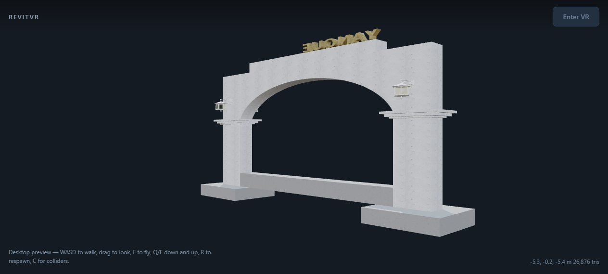

# IngeTrazo VR

One button in IngeTrazo. Put on the Quest. Walk the model you just drew — walls solid,
doorways passable.

An IngeTrazo extension that reproduces the RevitVR workflow: press **Extensions ▸ Export to
VR**, and seconds later you are inside the model in the headset's own browser (three.js +
WebXR), with no game engine and no APK to sideload.



Two halves are borrowed, one is new:

| Piece | Source |
|---|---|
| `scene.glb` — geometry, materials, embedded textures, Y-up, metres | IngeTrazo's own `formats.gltf.save_glb` (the call Render ▸ Blender makes) |
| Viewer, collision engine, desktop controls, collider overlay | RevitVR's `vr-web/`, with one addition: green ground planes in collider mode |
| Collider derivation — walls, floors, stairs, openings | **new**: `build_manifest` below |

## Install

Close IngeTrazo first — it loads plugins at startup.

```powershell
powershell -NoProfile -ExecutionPolicy Bypass -File install.ps1
```

That copies `ingetrazo_vr.py` to `%APPDATA%\ingetrazo\plugins\` and the viewer to
`%APPDATA%\ingetrazo\ingetrazo_vr_www\`. Restart IngeTrazo, open a model, and look in
**Extensions**.

## Use

**Extensions ▸ Export to VR** opens one dialog:

- **Export & open on Quest** — exports, serves, then `adb reverse` + opens the page on the
  headset, so WebXR is allowed with no certificate (the same trick RevitVR uses). Needs the
  headset over USB or wireless debugging; without adb it says so and gives you the https URL.
- **Export & desktop preview** — same thing in this PC's browser: WASD, drag to look, `F`
  fly, `R` respawn, `C` colliders.
- **Re-export only** — writes the scene again, leaves the page alone.

The dialog prints the addresses it is serving:

```
library:   http://localhost:8770/                       ← every exported model, newest first
model:     http://localhost:8770/viewer.html?model=…    ← the one just exported
headset:   https://192.168.86.100:8771/                 ← accept the certificate warning once
```

The export opens the model it just made; **‹ Library** in the viewer goes back to the list. Models
exported from RevitVR appear in the same list, because both plugins publish into one folder
(below).

**Why the headset needs the https one.** WebXR only exists in a *secure context*. `localhost`
counts as secure, so `adb reverse` (which makes the PC's server appear on the headset's own
localhost) needs no certificate at all. `http://192.168.x.x` does **not** count: the page
loads, `navigator.xr` is undefined and **Enter VR stays disabled** — which is a browser rule,
not this plugin. So the LAN side is served over TLS on port 8770+1 with a self-signed
certificate covering this PC's address (regenerated when the address changes). Tap
*Advanced ▸ Proceed* once on the headset; after that Enter VR works. The page says so itself
in a banner when opened over plain http.

Controls:

| | |
|---|---|
| Left stick | walk |
| Right stick left/right | snap turn, 30° per push — let it spring back before the next step |
| Right stick up/down | climb / descend while flying |
| **Right grip** | **toggle walk / fly** |
| Left grip | show the collision world |
| **Either trigger (hold)** | **fast navigation: 3× movement, walking or flying** |
| **Both triggers (hold)** | **double boost: 6× — twice the single-trigger boost** |
| Desktop | WASD, drag to look, `F` fly, `Q`/`E` down/up, `Shift` run, `R` respawn, `C` colliders |

The export runs on the GUI thread and reads only; it never adds an undo step or marks the
document dirty. Running the server is a background thread that touches the export directory,
never the document.

Where things go: `%LOCALAPPDATA%\IngeTrazo\VR\export\scene.glb` and `colliders.json` — the last
export, which is what `?scene=` opens. Every export is also published into the shared library at
`%LOCALAPPDATA%\VRHub\library\<model>\scene\`, beside a `meta.json` naming the source, the file,
and when it was exported.

## The model library

One homepage lists every model either plugin has exported:

```
%LOCALAPPDATA%\VRHub\library\
  farnsworth-house\        one folder per model file
    meta.json
    scene\                 scene.glb, colliders.json (+ railings.json / textures.json from Revit)
  196-sw-2025\
```

The folder is a slug of the document's file name, so exporting `Farnsworth House` again replaces
its contents and its card — the list never grows duplicates. The card shows the source (Revit or
IngeTrazo), the file, the export time, size and triangle count, and clicking it opens that model at
`/viewer.html?model=<slug>`.

RevitVR's server serves the same homepage and the same folder, so either plugin's address shows the
same list; a model exported from Revit is walkable from IngeTrazo's URL and the other way round.
Both plugins must be built from the same `vr-web` (the web app is mirrored between the two repos).

Press `C` (left grip in VR, or open the page with `?colliders`) to see what the
collision engine believes:

| Colour | Meaning |
|---|---|
| **Green** | a **walkable surface** — every floor polygon and terrain triangle you can stand on, at its height |
| **Magenta** | a wall run the exporter **removed as an opening**, drawn where it was removed — so a door tag or layer proves itself |
| Red | railing |
| Blue | wall |
| Amber | furniture, casework, columns, and any short barrier |
| Grey | anything else |

The green planes are drawn without a depth test, so they show through the model and through
ceilings — deliberate, because a floor's finish layer sits a few centimetres above the analytic
surface and a depth-tested decal disappears under the model's own floor exactly where you want to
see it. The boxes stay depth-tested, so walls still occlude properly.
Port 8770 by default, so it can run beside RevitVR's 8765.

## Performance

A model is exported with one node per group and per instance, and the viewer draws one mesh per
node. On a real site that arrived as **18,587 meshes holding 874k triangles** — 18k draw calls
per eye, per frame. A desktop GPU absorbs that; a headset does not, which is the whole
"fine on the PC, crawling in VR" difference.

So the viewer collapses the scene after loading: meshes are merged by material and by 30 m plan
cell, keeping frustum culling useful. Measured in Chrome on the same export, same camera:

| | meshes | ms per render |
|---|---|---|
| as exported | 18,587 | 87.96 |
| collapsed | 269 | 2.56 |

Add `?collapse=0` to the URL to see the difference for yourself — it skips the merge.

Two more knobs, both URL parameters, neither on by default:

- `?scale=0.8` — renders the headset at 80% linear resolution (`renderer.xr.setFramebufferScaleFactor`).
  The cheapest frame rate there is, paid for in softness. Range 0.4–1.5.
- `C` in the headset draws the collider world, including the green ground planes, which are
  deliberately not depth-tested. It costs overdraw — leave it off while you walk and switch it on
  to check something.

The collision world is not the bottleneck on this model: `groundAt` measured 0.016 ms per call
with 6,440 surfaces, and `resolve` rounds to 0 ms with 18,721 segments behind the spatial hash.

## How the collision world is derived

IngeTrazo has no parametric walls, doors or railings — a BIM tag is metadata on a face set,
not a wall object with a location curve. So the colliders come from the geometry:

| Rule | Result |
|---|---|
| upward-facing face, flat, no holes | a **walkable surface** (floor, roof, tread, tabletop) at its height |
| upward-facing face, sloped, or with a hole | **terrain triangles** — a hillside keeps its shape, a stairwell stays a hole |
| downward-facing face | nothing (ceiling) |
| vertical face ≥ 0.55 m tall | one **wall run** along its bottom edge, at the face's height |
| a hole in that face that reaches the floor | the run is **split** — that is a doorway |
| a hole that stops above the floor | the run stays whole — that is a window |
| a face ≤ 1.0 m tall whose top meets a walkable surface (a floor polygon **or a terrain triangle** — a stairwell floor is triangulated), with another walkable surface within 0.47 m below that top | **not a wall: a slab edge over a step.** The qualifying part of the run is dropped, so a floor's edge at the head of a stair is stepped onto instead of blocking |
| a face (or a group, at any depth) tagged `IfcDoor` / `IfcWindow`, **or on a layer whose name contains** door / puerta / window / ventana / opening / hueco | its own vertical faces stop being walls, and any wall run whose midpoint falls inside its plan box is dropped too. The layer list is editable in the export dialog, matched case-insensitively as a substring, so `Puertas`, `DOORS-1`, `Ventanas PB` all count |
| faces under 0.25 m long, 0.55 m tall, 0.04 m² | ignored (skirting, jambs, trim) |
| hidden objects and layers | not exported — `world_faces` respects visibility, as `save_glb` does |

Faces are read in world space with their paint resolved, so a component's instances arrive
placed correctly.

**There are no door objects to find.** IngeTrazo gives you faces, groups/components that hold
faces, and labels you attach to either — a layer, or an IFC class. So a "door" here is whatever
geometry you modelled, plus a label if you added one. The plugin reads it that way:

- **geometry** decides the walkable world — floors, treads, walls, and the holes that reach the
  floor, which are doorways with no label at all;
- **labels** only stop the door's own faces from being walls. If your opening is a real hole,
  tagging or layering the leaf changes nothing you can see.

A layer can sit on a **face** (`attrs["layer"]`, kept through component transforms and merged
meshes) or on a **group** (`group.layer`), and the group walk is recursive, so a leaf inside a
wall group is found when the leaf's own group carries the layer.

Nothing resolves a "door" into a cut in a wall the way Revit does: if the wall has no hole, no
tag or layer opens it.

**Spawn:** on the model's own lowest level, at the point with the most clearance from any
wall, facing the most open direction. If the base has nowhere roomy to stand (a monument, a
kerb), it stands 2 m in front of the model instead and says so in the report.

## What is verified, and on what

| Check | Result |
|---|---|
| Derivation rules (rooms, doorways, windows, stairs, slopes, door tags, up-axis, stair-head slab edges, interior floors) | `python tools/test_derive.py` — 33 assertions, all pass |
| Collision against the real engine | `node tools/collide_probe.mjs <manifest>` — walls stop a body, floors are ground, spawn is standable |
| Stair head on a real building (`Casa en los Arboles`) | `node tools/walk_probe.mjs` from the top tread onto the floor above: **blocked at 0.31 m before, 1.20 of 1.20 m through after** |
| Export of a real model (`arco-yanque.igz`) | 10,368 faces → 3.5 MB GLB in 0.5 s; **Khronos gltf-validator: 0 errors**, 1 warning (an image's colour profile) |
| The viewer with that export | renders with textures; colliders line up with the geometry (`docs/colliders.png`) |
| Plugin loads in the host | registered as `ingetrazo_plugin_ingetrazo_vr`, `ExportVrTool` present in `Tool.__subclasses__()` |
| The dialog path | constructed and driven headless: export, report, server, LAN address |
| **Secure origin for the headset** | plain http over LAN: `isSecureContext=false`, `navigator.xr` absent, Enter VR disabled — reproduced. Over https: `isSecureContext=true`, `navigator.xr` present, banner gone |
| GLB image types | a model whose GLB declared a PNG as `image/jpeg` (validator **error**) is now corrected on export: same file validates **0 errors, 0 warnings** |
| **Headset** | **not run** — no headset over adb on this machine at the time |

## Known limits

- **No BIM tags on the test model**, so openings were read from geometry alone (a hole that
  reaches the floor). Tagged models also get the `IfcDoor`/`IfcWindow` exclusion.
- **A 0.3.x build cannot triangulate a face with holes** (its `meshexport` has no
  `export_triangles`): such a floor is walked as if solid, and the report says how many. The
  current source has the helper; the plugin uses it when present.
- **No occlusion bake, no lighting work** — the GLB is the model as exported, and the viewer
  shades it with one sun plus an environment probe.
- **A slab edge is only a step if the floor above it is a walkable face.** If that
  floor's top is missing from the model (not drawn, or on a hidden layer), the edge stays a wall
  and you stop one riser below it — the report names the count of edges treated as steps.
- **No section-plane cropping**: hiding layers/objects is respected, a section cut is not.
- **Sections of a wall thicker than it looks**: each vertical face becomes its own 0.10 m
  plane, so a wall is blocked at its two surfaces rather than as one box. You cannot walk
  through it, but a wall thinner than the capsule radius is treated as solid.
- **Plugin API is 0.x** and explicitly unstable: `formats.meshexport`'s public names already
  differ between the installed 0.3.x and `main` (handled), and the workspace/exporter
  protocols may change. Exporter *registration* is on IngeTrazo's roadmap but not done, which
  is why this is an Extensions menu tool rather than File ▸ Export.

## Files

```
ingetrazo_vr.py            the plugin (single file; stdlib only at import time)
ingetrazo_vr_www/          the shared web app: model library homepage + WebXR viewer
                           (a mirror of RevitVR's vr-web/ — keep the two identical)
tools/test_derive.py       derivation rules, no IngeTrazo needed
tools/test_library.py      the shared library: slugs, replace-on-export, server routes
tools/collide_probe.mjs    a manifest against the real collision engine
tools/serve_test.py        serve any scene directory for a browser check
tools/serve_https.py       the same plus TLS on a second port (headset check)
tools/fix_glb.py           correct an existing GLB's image MIME types
tools/refilter_manifest.py re-apply the collider rules to an existing manifest
tools/walk_probe.mjs       walk a body through a manifest with the real engine
tools/diagnose_stairs.py   find flights and whatever blocks their top tread
tools/probe_glb.py         the triangles actually modelled around a point
tools/vrtest_plugin.py     headless harness: probes the installed API, runs one export
install.ps1                install to %APPDATA%\ingetrazo
docs/                      screenshots from the real export
```

Tuning lives at the top of `ingetrazo_vr.py` (`MIN_WALL_H`, `MIN_RUN_LEN`, `SEG_THICKNESS`,
`MIN_SURFACE_AREA`, `EYE_HEIGHT`, `DEFAULT_PORT`).
